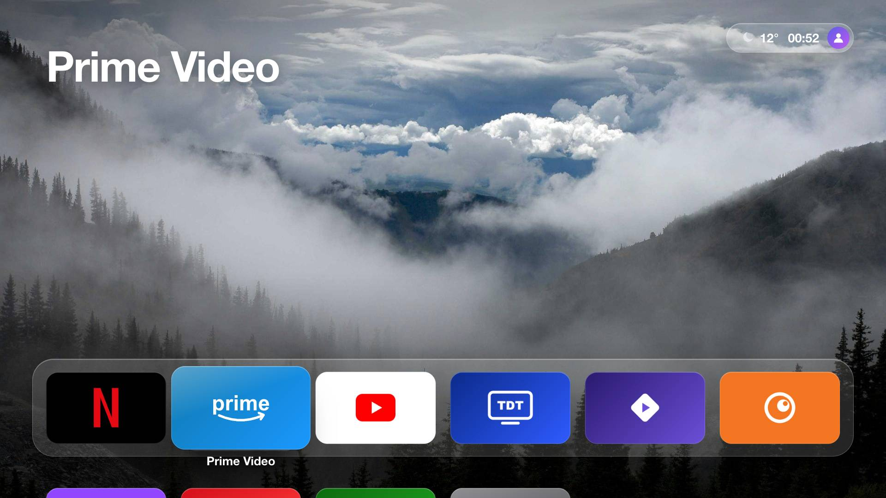
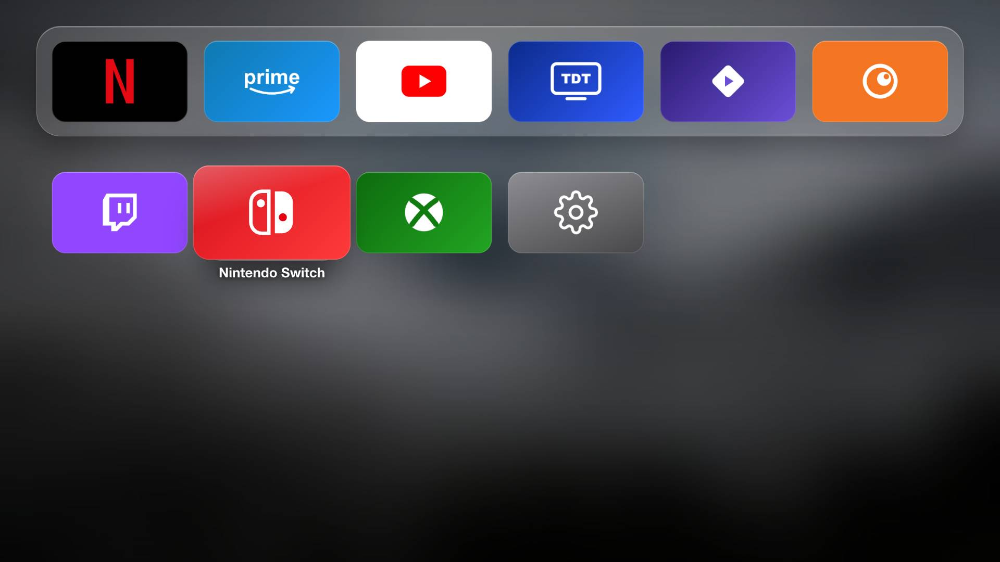
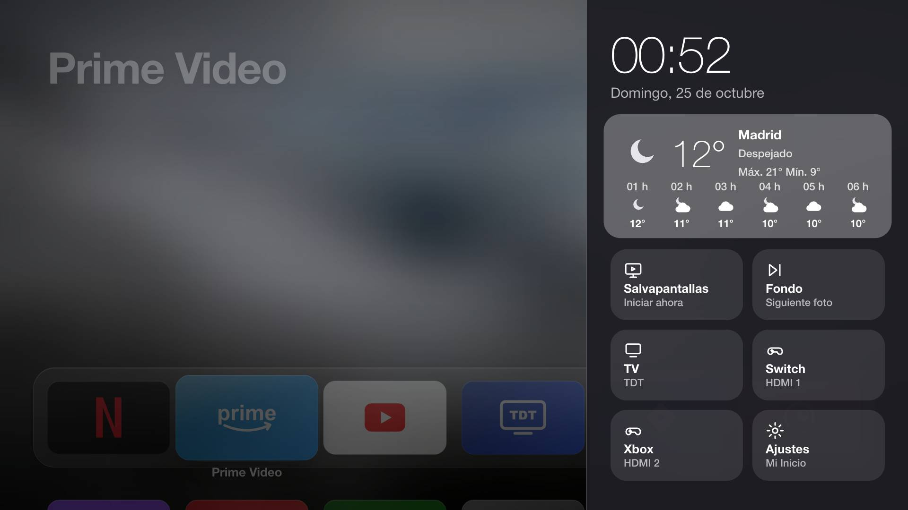
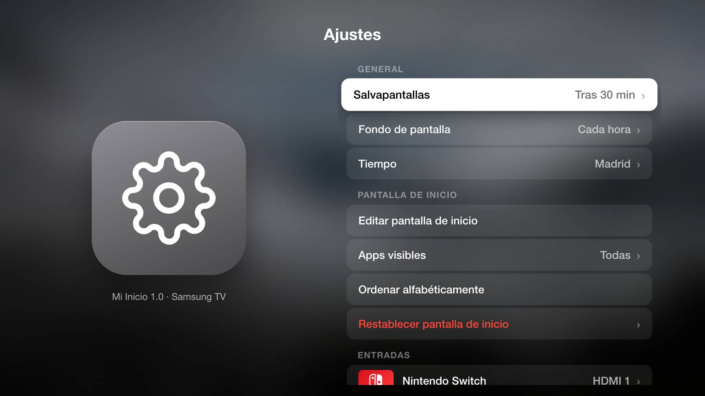

# Mi Inicio — pantalla de inicio estilo Apple TV para teles Samsung (Tizen)

Una pantalla de inicio limpia, rápida y personalizable para televisores Samsung con Tizen, inspirada en tvOS 26 («Liquid Glass»). Es una app web normal de Tizen: **no hace falta root** para usarla. Solo el paso avanzado opcional (que el botón Home la abra) usa una sesión de root temporal.

*A clean, fast, Apple TV–style home screen for Samsung Tizen TVs. Spanish UI. Installs as a regular Tizen web app via Developer Mode; root is only needed for the optional Home-button step.*



| Rejilla de apps | Centro de control | Ajustes |
|---|---|---|
|  |  |  |

## Qué incluye

- **Inicio estilo tvOS**: foto de paisaje a pantalla completa, fila superior sobre una plataforma de cristal, rejilla de 6 columnas con el nombre bajo la app enfocada y fondo difuminado al bajar.
- **Tus apps reales**, con su icono oficial, detectadas solas. Puedes mover, ocultar u ordenar apps (mantén **OK** o pulsa el botón **amarillo**).
- **Entradas**: TDT (sintoniza un canal de antena, no Samsung TV Plus), Nintendo Switch y Xbox. El puerto HDMI se detecta por HDMI-CEC o se elige en Ajustes.
- **Tiempo**: AEMET para ciudades españolas (sin clave) y Open-Meteo para el resto o en modo automático por IP.
- **Centro de control** (botón **rojo**, o subir a la píldora de arriba a la derecha): previsión por horas, salvapantallas, fondo, entradas y ajustes.
- **Ajustes** (icono de la rejilla o botón **azul**): salvapantallas, fondo, tiempo, apps visibles, puertos HDMI, volumen y accesos directos a los paneles de Samsung (imagen y sonido, wifi, Bluetooth, compartir pantalla…).
- **Salvapantallas** en movimiento que protege el OLED (por defecto a los 30 minutos), con imágenes de la NASA de fondo casi negro que en OLED gastan menos, o paisajes. Mientras Mi Inicio está abierto, pide a la tele que no use el de Samsung.
- **Ligera**: pensada para el Chromium 85 de Tizen 6.5; animaciones solo con `transform`/`opacity`.

## Compatibilidad

Probado en un televisor Samsung de 2022 con **Tizen 6.5**. Debería funcionar en modelos de 2019 en adelante (Tizen 5+), pero no está probado. Si lo pruebas en otro modelo, abre un issue contando qué tal.

## Instalación (sin root)

Necesitas un ordenador (macOS, Windows o Linux) en la **misma red** que la tele.

### 1. Herramientas (una vez)

1. Instala **[Tizen Studio](https://developer.tizen.org/development/tizen-studio/download)** (versión con IDE). En Mac con Apple Silicon funciona con Rosetta.
2. En Tizen Studio abre **Package Manager** e instala:
   - **TV Extensions** (Extension SDK).
   - **Samsung Certificate Extension** (Extension SDK).
3. Añade las herramientas al `PATH` (macOS/Linux):
   ```sh
   export PATH="$HOME/tizen-studio/tools:$HOME/tizen-studio/tools/ide/bin:$PATH"
   sdb version && tizen version
   ```

### 2. Certificado de Samsung (una vez)

En Tizen Studio: **Tools → Certificate Manager → +** → perfil **Samsung**, tipo **TV**. Inicia sesión con tu cuenta Samsung cuando lo pida. Apunta el **nombre del perfil** (lo usarás como `CERT_PROFILE`).

> Si falla con `ArrayIndexOutOfBoundsException`, algún bloqueador de anuncios o DNS está bloqueando los servidores de certificados de Samsung.

### 3. Modo desarrollador en la tele (una vez)

1. Abre **Apps** en la tele y teclea **1 2 3 4 5** con el mando.
2. Activa **Developer mode** y en **Host PC IP** escribe la IP de tu ordenador.
3. Reinicia la tele (mantén pulsado el botón de encendido del mando hasta que se reinicie).
4. Busca la IP de la tele en *Ajustes → General → Red → Estado de red*.

### 4. Instalar Mi Inicio

```sh
git clone https://github.com/miguelmg4/samsung-tizen-home.git
cd samsung-tizen-home
TV_IP=192.168.1.50 CERT_PROFILE=MiPerfil ./deploy.sh
```

Mi Inicio aparecerá en tus apps. Ponla la primera de la barra de Samsung (mantén pulsado sobre ella → Mover).

Para actualizar tras cambiar algo, vuelve a ejecutar `./deploy.sh`.

## Uso con el mando

| Tecla | Acción |
|---|---|
| Flechas / OK | Navegar / abrir |
| Mantener OK o **amarillo** | Menú: abrir, editar pantalla de inicio, mover a la fila superior, ocultar |
| **Rojo** | Centro de control |
| **Azul** | Ajustes |
| VOLVER | Subir a la primera fila; en la primera fila, salvapantallas |

En mandos sin teclas de colores (SolarCell), pulsa el botón **123** para ver el mando virtual con colores.

## Personalizar

Todo está en `app/index.html`, en el bloque `CONFIGURACIÓN`:

- `DEFAULT_ORDER`: orden inicial de apps (la primera fila es el «Dock»).
- `BRAND`: color e icono de respaldo de cada app conocida.
- `INPUTS`: consolas y puertos HDMI por defecto.
- `PHOTOS`: fotos de fondo (en `app/photos/`, con versiones `blur/`, `mid/` y `thumb/`).
- `CITIES`: ciudades con su código de municipio de AEMET.

## Avanzado (opcional, con root temporal)

> ⚠️ **Bajo tu responsabilidad.** Estos pasos ejecutan órdenes como root en la tele mediante una sesión **temporal**: no se modifica el firmware, no se instala ningún servicio permanente y cada sesión comprueba que los archivos del sistema no cambian. Aun así, solo se han probado en un modelo. Haz siempre la copia de seguridad que hace el script.

Requisitos extra: **Python 3.9+** y el **SDK de .NET 6** ([descarga](https://dotnet.microsoft.com/download/dotnet/6.0), o `dotnet-install.sh --channel 6.0`). Los scripts compilan solos los ayudantes la primera vez (`tools/build-helpers.sh`).

### Que el botón Home abra Mi Inicio (y al encender)

```sh
TV_IP=192.168.1.50 bash set-home.sh
```

Después, en la tele: *Ajustes → General → Funciones Smart →* activa **«Ejecutar Smart Hub»** para que se abra al encender.

**Volver al Home de Samsung** (¡siempre antes de desinstalar Mi Inicio!):

```sh
TV_IP=192.168.1.50 bash set-home.sh stock
```

### Quitar anuncios, rastreo y extras

Desactiva (no desinstala) componentes de Samsung con la herramienta de paquetes de Tizen. Es persistente y reversible.

```sh
TV_IP=192.168.1.50 bash debloat.sh inspect           # solo lectura: qué gasta memoria
TV_IP=192.168.1.50 bash debloat.sh check             # solo lectura: qué se desactivaría
TV_IP=192.168.1.50 bash debloat.sh apply             # grupos por defecto: ads,tracking,promo
TV_IP=192.168.1.50 bash debloat.sh apply ads,tracking,promo,alexa,smartthings
TV_IP=192.168.1.50 bash debloat.sh restore           # reactiva lo desactivado
```

Grupos: `ads`, `tracking`, `promo`, `alexa`, `health`, `smartthings`, `art`, `bixby` (solo lo exclusivo de Bixby; la voz dentro de apps sigue funcionando), `applevideo` (app Apple TV) y `samsunghome` (extras del inicio de Samsung; solo si ya usaste `set-home.sh`). Reinicia la tele después de aplicar.

## Limitaciones conocidas

- Sin root, el botón Home siempre abre el inicio de Samsung.
- Samsung no deja a las apps cambiar el modo de imagen, el wifi o el Bluetooth: Ajustes abre los paneles originales de Samsung.
- La app solo controla el salvapantallas de Samsung mientras está abierta.
- La conexión `sdb` con la tele se cae a menudo; los scripts reconectan solos.

## Desinstalar

1. Si usaste `set-home.sh`, ejecuta antes `set-home.sh stock`.
2. En la tele: Apps → ⚙ → Mi Inicio → Eliminar, o `tizen uninstall -p MiInicioTV.Home -s $TV_IP:26101`.
3. Desactiva el modo desarrollador si ya no lo necesitas.

## Créditos

- Herramientas de root y botón Home: [berteotti/custom-tv](https://github.com/berteotti/custom-tv) (MIT) y [chris-ritsen/samsung-tv-root](https://github.com/chris-ritsen/samsung-tv-root) (Unlicense).
- Fotos: autores de [Unsplash](https://unsplash.com) (lista en [THIRD_PARTY_NOTICES.md](THIRD_PARTY_NOTICES.md)).
- Tiempo: [AEMET](https://www.aemet.es) y [Open-Meteo](https://open-meteo.com).

Proyecto no oficial, sin relación con Samsung ni Apple. Licencia [MIT](LICENSE).
